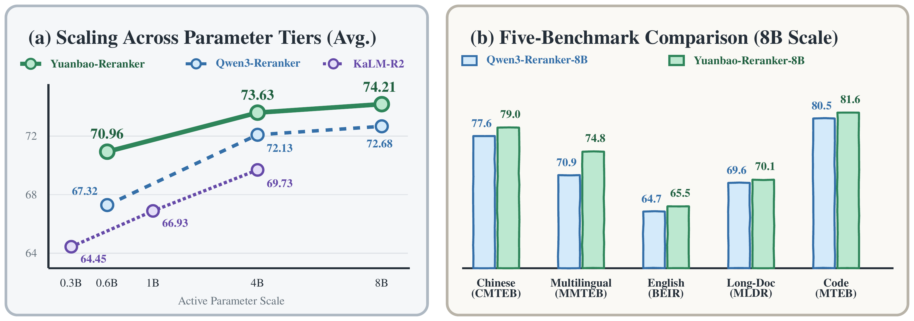
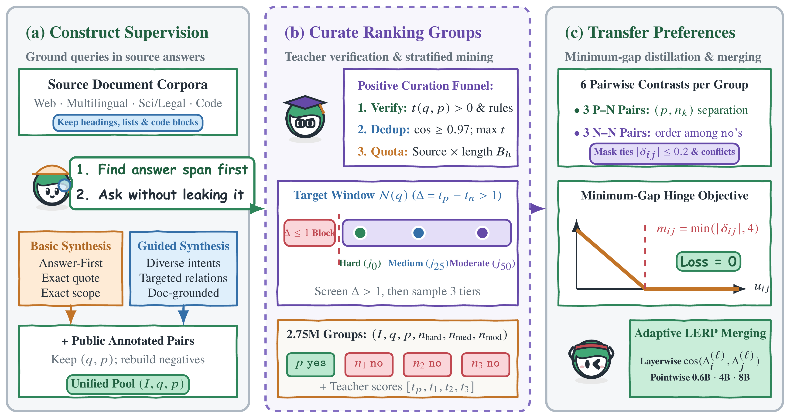

<div align="center">


# Yuanbao-Reranker

**Document-Grounded Synthesis and Preference Distillation for Text Reranking**

[](https://huggingface.co/collections/Yuanbao-Search/yuanbao-reranker-6aeda9e8d327ee5c9b20c9d6)
[](https://opensource.org/licenses/Apache-2.0)

[Model Zoo](#model-zoo) · [Quick Start](#quick-start) · [Benchmark Results](#benchmark-results) · [Training](#training) · [Evaluation](#evaluation) · [Citation](#citation)

</div>

**Yuanbao-Reranker** is a family of general-purpose dense pointwise text rerankers spanning **0.6B, 4B, and 8B** parameter scales built upon the Qwen3 backbone. Given a search query, task instruction, and candidate documents, it predicts fine-grained relevance scores in `[0, 1]` across Chinese, multilingual, English, long-document (up to 8,192 tokens), and code retrieval tasks.

### Key Highlights

- **Cross-Tier Ranking Superiority:** Across five comprehensive benchmark panels (CMTEB-R, MMTEB-R, BEIR, MLDR, and MTEB-Code), **Yuanbao-Reranker-0.6B** reaches **70.96 Avg.**, outperforming Qwen3-Reranker-0.6B (+3.64), jina-reranker-v3.5 (+2.78), and 1B–4B active-parameter baselines such as KaLM-Reranker-Large-R2 (69.73). **Yuanbao-Reranker-4B** reaches **73.63 Avg.** to surpass the 8B teacher (Qwen3-Reranker-8B, 72.68), and **Yuanbao-Reranker-8B** achieves a state-of-the-art **74.21 Avg.**
- **Document-Grounded Synthesis & Stratified Group Curation:** Constructed 2.75M 1:3 ranking groups by combining *answer-first* and *query-type-guided* synthesis with a three-stage curation funnel (teacher verification, semantic deduplication, and source-by-length quota allocation) and teacher-screened ($\Delta > 1$) difficulty-stratified negative mining (*Hard*, *Medium*, and *Moderate* tiers).
- **Bounded Minimum-Gap Preference Distillation:** Jointly optimizes pointwise `yes`/`no` cross-entropy with a capped one-sided pairwise hinge objective over both positive–negative and negative–negative pairs, followed by layerwise **Adaptive LERP** model merging with zero additional inference overhead.

<div align="center">
  
</div>

## Model Zoo

| Model | Parameters | Layers | Context Length | Five-Panel Avg. | Hugging Face Checkpoint |
| :--- | :---: | :---: | :---: | :---: | :--- |
| **Yuanbao-Reranker-0.6B** | 0.6B | 28 | 8,192 | **70.96** | [`Yuanbao-Search/Yuanbao-Reranker-0.6B`](https://huggingface.co/Yuanbao-Search/Yuanbao-Reranker-0.6B) |
| **Yuanbao-Reranker-4B** | 4B | 36 | 8,192 | **73.63** | [`Yuanbao-Search/Yuanbao-Reranker-4B`](https://huggingface.co/Yuanbao-Search/Yuanbao-Reranker-4B) |
| **Yuanbao-Reranker-8B** | 8B | 36 | 8,192 | **74.21** | [`Yuanbao-Search/Yuanbao-Reranker-8B`](https://huggingface.co/Yuanbao-Search/Yuanbao-Reranker-8B) |

## Quick Start

Use Python 3.10+. Both **Hugging Face Transformers** (local GPU/CPU inference) and **vLLM** (high-throughput serving and benchmark reproduction) are supported.

### 1. Python API (`Transformers` or `vLLM`)

Install dependencies from the repository root:

For Transformers:

```bash
python -m pip install -r requirements/inference.txt
python -m pip install -e .
```

For vLLM:

```bash
python -m pip install -r requirements/eval.txt
python -m pip install -e .
```

Score and rerank candidate documents for a query:

```python
from yuanbao_reranker import YuanbaoReranker

model = YuanbaoReranker("Yuanbao-Search/Yuanbao-Reranker-0.6B", backend="transformers")

results = model.rerank(
    query="What is the capital of China?",
    documents=[
        "Beijing is the capital of China.",
        "Shanghai is a major financial center.",
        "北京是中国的首都。",
    ],
    instruction="Given a web search query, retrieve relevant passages that answer the query",
    top_n=2,
)
for item in results:
    print(f"[{item['index']}] score={item['relevance_score']:.4f} | {item['document']}")
```

For code search or domain-specific tasks, pass the task instruction explicitly:

```python
results = model.rerank(
    query="Sort a list of integers in ascending order.",
    documents=["sorted(values)", "sum(values)"],
    instruction="Given a code comment, retrieve the code snippet corresponding to that comment.",
)
```

`rerank` returns documents in descending score order with `index`, `document`, and `relevance_score` in `[0, 1]`. For full-precision CPU inference with Transformers, pass `backend="transformers", device="cpu", dtype="float32"`.

### 2. Command-Line Scoring (`yuanbao_reranker.score`)

```bash
python -m yuanbao_reranker.score \
  --model Yuanbao-Search/Yuanbao-Reranker-0.6B \
  --backend transformers \
  --query "中国的首都是哪里？" \
  --doc "北京是中国的首都。" \
  --doc "上海是中国的金融中心之一。"
```

For benchmark-aligned settings, select the matching `--task` from the evaluation catalog:

```bash
python -m yuanbao_reranker.score \
  --model Yuanbao-Search/Yuanbao-Reranker-0.6B \
  --config configs/eval-0.6B.json \
  --task MultiLongDocRetrieval \
  --query "中国的首都是哪里？" \
  --doc "北京是中国的首都。"
```

### Recommended Task Instructions

Yuanbao-Reranker is instruction-aware. You can customize `<Instruct>` to specify the target relevance criteria for your scenario:

| Retrieval Scenario | Recommended `instruction` |
| :--- | :--- |
| **General Web Search & RAG (Default)** | `Given a web search query, retrieve relevant passages that answer the query` |
| **Chinese Web Passage Retrieval** | `Given a Chinese search query, retrieve web passages that answer the question` |
| **Long-Document Retrieval (up to 8K)** | `Given a web search query, retrieve relevant passages that answer the query` |
| **Natural Language to Code Search** | `Given a code comment, retrieve the code snippet corresponding to that comment.` |
| **Technical & Coding QA** | `Given a question about coding, retrieval code or passage that can solve user's question` |
| **Fact & Claim Verification** | `Given a claim, retrieve documents that support or refute the claim` |
| **Legal Statute & Case Retrieval** | `Identifying the most relevant statutes for a given situation` |

For benchmark reproduction, select the task with `--task` to use its instruction from `task_prompts.json`.

> **Tip:** For custom domain tasks, formulate a concise English instruction describing what constitutes a relevant document for the query (e.g., `"Given a financial inquiry, retrieve relevant earnings report passages that answer the question"`).

## Benchmark Results

### 1. Main Results on Qwen Top-100

All models rerank the shared **Qwen Top-100** candidate pool (Top-100 candidates per query retrieved by `Qwen3-Embedding-0.6B`) across five comprehensive benchmark panels (**nDCG@10 × 100**):

| Model | Params (Act. / Tot.) | CMTEB-R | MMTEB-R | BEIR | MLDR | MTEB-Code | **Avg.** |
| :--- | :---: | ---: | ---: | ---: | ---: | ---: | ---: |
| *Sub-1B Compact Models (< 1B Active)* | | | | | | | |
| mxbai-rerank-base-v2 | 0.5B | 69.77 | 59.04 | 58.22 | 42.99 | 68.01 | 59.61 |
| bge-reranker-v2-m3 | 0.57B | 72.14 | 58.27 | 55.48 | 59.41 | 41.34 | 57.33 |
| Querit-Reranker-A0.4B | 0.43B / 4.92B | 70.44 | 61.42 | 57.78 | 56.55 | 65.78 | 62.39 |
| KaLM-Reranker-Nano-R2 | 0.27B / 0.79B | 70.00 | 62.26 | 58.47 | 66.13 | 65.38 | 64.45 |
| jina-reranker-v3.5 | 0.6B | 73.96 | 66.71 | **61.32** | 65.01 | 73.90 | 68.18 |
| Qwen3-Reranker-0.6B | 0.6B | 71.43 | 65.61 | 59.61 | 66.89 | 73.03 | 67.32 |
| **Yuanbao-Reranker-0.6B** | **0.6B** | **75.60** | **70.49** | 61.30 | **68.94** | **78.44** | **70.96** |
| *Mid-Sized Models (1B–4B Active)* | | | | | | | |
| KaLM-Reranker-Small-R2 | 1B / 2.12B | 73.18 | 64.17 | 60.90 | 67.29 | 69.09 | 66.93 |
| mxbai-rerank-large-v2 | 1.54B | 72.09 | 64.74 | 60.23 | 54.25 | 72.78 | 64.82 |
| bge-reranker-v2-gemma | 2.51B | 72.35 | 65.89 | 60.29 | 47.30 | 64.26 | 62.02 |
| Querit-Reranker-Dense-4B | 4B | 73.02 | 66.55 | 59.87 | 49.98 | 73.76 | 64.64 |
| KaLM-Reranker-Large-R2 | 4B / 7.51B | 75.58 | 66.86 | 62.72 | 69.72 | 73.75 | 69.73 |
| Qwen3-Reranker-4B | 4B | 76.05 | 71.29 | 63.66 | 69.35 | 80.33 | 72.13 |
| **Yuanbao-Reranker-4B** | **4B** | **78.31** | **74.08** | **64.74** | **70.04** | **80.98** | **73.63** |
| *Large Models (8B)* | | | | | | | |
| Qwen3-Reranker-8B | 8B | 77.61 | 70.90 | 64.74 | 69.63 | 80.50 | 72.68 |
| **Yuanbao-Reranker-8B** | **8B** | **78.99** | **74.84** | **65.51** | **70.12** | **81.58** | **74.21** |

### 2. Cross-Retriever Generalization on Harrier Top-100

Evaluations on Top-100 candidate pools retrieved by `Harrier-OSS-v1-0.6B` verify that these gains generalize robustly across distinct first-stage candidate generators:

| Model | CMTEB-R | MMTEB-R | BEIR | MLDR | MTEB-Code | **Avg.** |
| :--- | ---: | ---: | ---: | ---: | ---: | ---: |
| Qwen3-Reranker-0.6B | 71.16 | 67.55 | 60.30 | 63.25 | 72.90 | 67.03 |
| **Yuanbao-Reranker-0.6B** | **75.41** | **74.81** | **61.68** | **65.29** | **78.15** | **71.07** (+4.03) |
| Qwen3-Reranker-4B | 75.74 | 73.18 | 64.24 | **66.01** | 79.92 | 71.82 |
| **Yuanbao-Reranker-4B** | **78.11** | **81.82** | **65.33** | 65.98 | **80.60** | **74.37** (+2.55) |
| Qwen3-Reranker-8B | 77.39 | 72.87 | 65.37 | 65.74 | 80.13 | 72.30 |
| **Yuanbao-Reranker-8B** | **78.76** | **81.21** | **66.02** | **66.24** | **81.15** | **74.68** (+2.37) |

## Training

<div align="center">
  
</div>

Install the training dependencies in a separate environment:

```bash
python -m pip install -r requirements/train.txt
python -m pip install -e .
```

Run a two-step verification on the bundled sample groups (`examples/toy_train.jsonl`):

```bash
python -m yuanbao_reranker.train \
  --config configs/train-toy.json \
  --data examples/toy_train.jsonl \
  --output outputs/toy
```

For distributed training with joint pointwise SFT and bounded minimum-gap hinge distillation:

```bash
torchrun --standalone --nproc_per_node=8 -m yuanbao_reranker.train \
  --config configs/train-0.6B.json \
  --data /path/to/train.jsonl \
  --output outputs/yuanbao-reranker-0.6B
```

See [Training](docs/training.md) for the `1:3` group JSONL schema, objective formulation, and multi-node DeepSpeed ZeRO-2 configuration.

## Evaluation

Prepare a benchmark task using its corpus, queries, relevance labels, and retrieval results, then rerank its Top-100 candidates:

```bash
python -m yuanbao_reranker.evaluate \
  --model Yuanbao-Search/Yuanbao-Reranker-0.6B \
  --config configs/eval-0.6B.json \
  --data /path/to/prepared-task \
  --output results/0.6B/T2Retrieval
```

See [Evaluation](docs/evaluation.md) for data preparation, first-stage retrieval, task prompts, and aggregation across all five benchmark panels.

## Citation

```bibtex
@article{yuanbao_reranker_2026,
  title={Yuanbao-Reranker: Document-Grounded Synthesis and Preference Distillation for Text Reranking},
  author={Xu, Hongyuan and Ye, Dezhi and Cao, Jiahao and Liu, Jie and Liang, Haijin and Shi, Haibo and Ma, Jin},
  journal={arXiv preprint},
  year={2026}
}
```

## Acknowledgments

Built upon the [Qwen3](https://github.com/QwenLM/Qwen3) model family. Training follows the Qwen chat format used by [LLaMA-Factory](https://github.com/hiyouga/LLaMA-Factory). Evaluation uses [MTEB](https://github.com/embeddings-benchmark/mteb) and [pytrec_eval](https://github.com/terrierteam/pytrec_eval). See [NOTICE](NOTICE).
